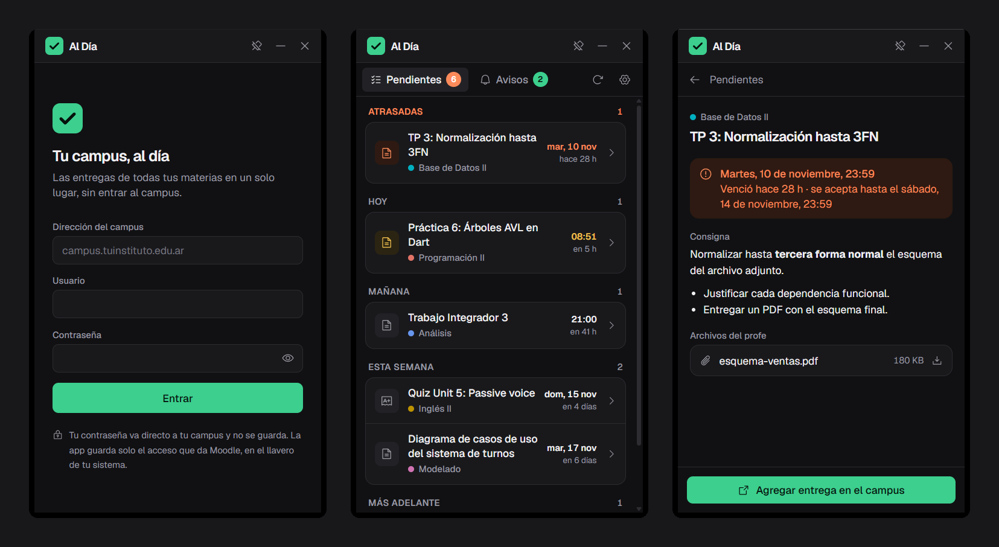

# Al Día

Widget de escritorio con las entregas de tu campus **Moodle**: qué vence hoy, mañana y esta semana, qué quedó atrasado, la consigna de cada tarea, los archivos del profe y los avisos de tus materias, sin entrar al campus. Te avisa antes de cada vencimiento.

Funciona con cualquier Moodle que permita entrar desde la app oficial (la mayoría: institutos, universidades y colegios). Windows, macOS y Linux.

**[Descargar el instalador](https://github.com/lautarocuelllo-bit/al-dia/releases/latest)** · En Windows es el archivo que termina en `x64-setup.exe` (2,4 MB)



## Qué hace

- **Pendientes agrupados**: atrasadas, hoy, mañana, esta semana y más adelante. Es la misma lista que la "Línea de tiempo" del panel de Moodle, de todas las materias juntas.
- **Detalle de cada tarea**: consigna, archivos del profe, fecha límite con atraso permitido y si ya la entregaste.
- **Abrir en el campus ya logueado**: el botón lleva directo a la tarea sin volver a iniciar sesión.
- **Recordatorios** del sistema antes de cada entrega (1 hora, 3, 12, 1 día o 2 días antes) y aviso cuando un profe publica algo.
- **Avisos** del campus con el contador de no leídos. Al abrirlos quedan leídos también en Moodle.
- **Widget**: ventana chica que se puede fijar encima de todo, se esconde en la bandeja al cerrarla y puede abrirse sola al prender la compu. Tema claro y oscuro.

## Privacidad

- La contraseña va **directo a tu campus** (el mismo pedido que hace la app oficial de Moodle) y no se guarda.
- Se guarda solo el acceso que devuelve Moodle, en el **llavero del sistema** (Administrador de credenciales en Windows, Llavero en macOS).
- **No hay servidor propio** ni estadísticas: la app habla únicamente con tu campus.
- El HTML que viene del campus (consignas, avisos) se limpia con DOMPurify antes de mostrarse.

## Cómo funciona

Usa la API de servicios web de Moodle con el servicio `moodle_mobile_app`:

| Para | Función de Moodle |
|---|---|
| Iniciar sesión | `login/token.php` |
| Pendientes | `core_calendar_get_action_events_by_timesort` |
| Consigna y archivos | `mod_assign_get_assignments`, `mod_assign_get_submission_status` |
| Avisos | `message_popup_get_popup_notifications`, `core_message_mark_notification_read` |
| Abrir logueado | `tool_mobile_get_autologin_key` |

Las llamadas las hace Rust (`tauri-plugin-http`), así no hay problemas de CORS con ningún campus.

## Tecnologías

- **[Tauri 2](https://tauri.app)** (Rust): instaladores livianos, bandeja del sistema, notificaciones, inicio automático y llavero.
- **React 19 + TypeScript + Vite** y **Tailwind CSS 4** para la interfaz.

## Desarrollo

Necesitás [Node 20+](https://nodejs.org) y [Rust](https://rustup.rs) (en Windows, también las Build Tools de Visual Studio con C++).

```bash
npm install
npm run app          # abre la app en modo desarrollo
npm run instalador   # genera el instalador en src-tauri/target/release/bundle/
```

Para probar sin un campus real hay un **Moodle de demostración** con datos inventados:

```bash
npm run demo         # http://localhost:8099 · usuario demo, contraseña demo
```

y en la app se entra con la dirección `http://localhost:8099`. La interfaz también se puede abrir en el navegador con `npm run dev` (útil para diseñar).

### Publicar una versión

La versión sale de `version` en `package.json` (Tauri la toma de ahí). Al subir la etiqueta, GitHub Actions compila los instaladores de Windows, macOS y Linux y los deja en un release borrador para revisarlo y publicarlo:

```bash
git tag v0.1.0
git push origin v0.1.0
```

## Estructura

```
src/
├── App.tsx                 Pestañas: pendientes, avisos y ajustes
├── components/             Ingreso, lista, detalle, avisos, ajustes y barra de la ventana
└── lib/
    ├── moodle.ts           Cliente de la API de Moodle
    ├── useCampus.ts        Sesión, actualización cada 15 minutos y recordatorios
    ├── plataforma.ts       Lo que cambia entre la app y el navegador (HTTP, llavero, notificaciones)
    └── tiempo.ts           Agrupar por fecha y formatos
src-tauri/                  Ventana sin marco, bandeja, llavero y permisos
scripts/moodle-demo.mjs     Moodle de demostración
.github/workflows/          Instaladores para Windows, macOS y Linux al subir una etiqueta
```

## Instalarla

Los instaladores no están firmados (firmar cuesta dinero), así que el sistema avisa la primera vez:

- **Windows**: "Windows protegió tu PC" → *Más información* → *Ejecutar de todas formas*.
- **macOS**: clic derecho sobre la app → *Abrir*.

---

Hecho por Lautaro Cuello · [Genesis CodeStudio](https://genesiscodestudio.com)
